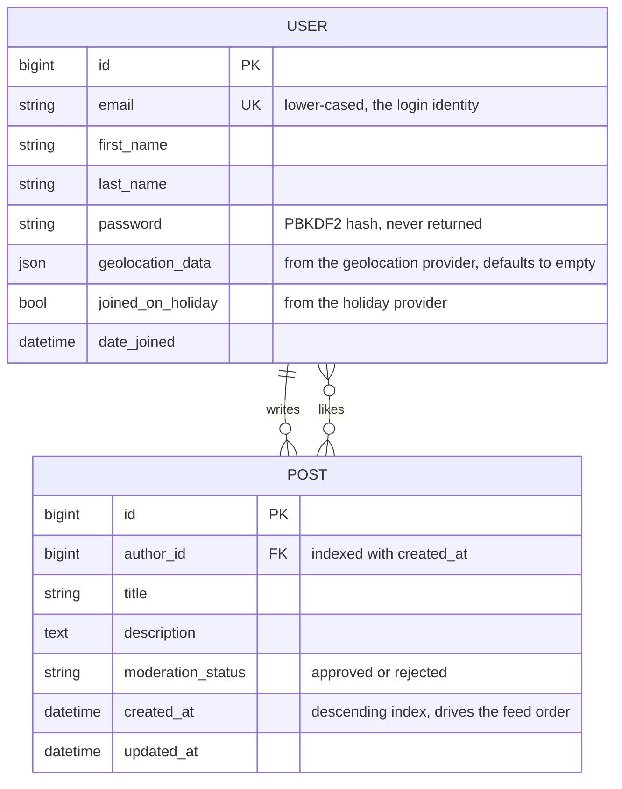
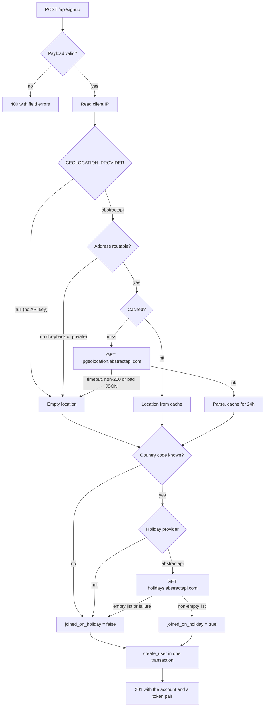
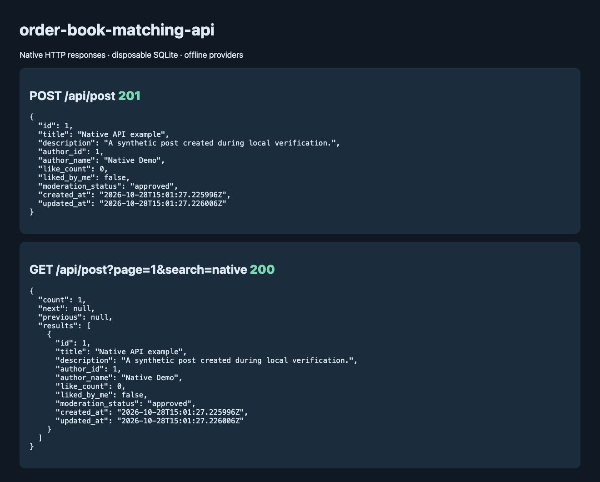

# TradeCore posts API

A small Django REST API where people register, write short posts, and like each
other's. Two things about it are less ordinary than that description suggests:
an account is decorated at sign-up with the country it was created from and
whether that day was a public holiday there, and every post is run past a
moderator before it is stored.

Both reach outside the process, and both would normally mean the project only
runs for someone holding three API keys. Each integration instead sits behind a
port with an offline implementation, chosen automatically when no key is
present, so `git clone && manage.py runserver` gives you a working API —
registration included — with nothing configured.

## A round trip in five requests

```bash
BASE=http://127.0.0.1:8000/api

# 1. Register. Returns the account plus an access/refresh pair.
curl -X POST $BASE/signup -H 'Content-Type: application/json' -d '{
  "email": "ada@example.com", "password": "lovelace-engine-1843",
  "first_name": "Ada", "last_name": "Lovelace"
}'

# 2. Log in and keep the token.
TOKEN=$(curl -s -X POST $BASE/login -H 'Content-Type: application/json' \
  -d '{"email":"ada@example.com","password":"lovelace-engine-1843"}' \
  | python3 -c 'import sys,json; print(json.load(sys.stdin)["token"])')

# 3. Write a post.
curl -X POST $BASE/post -H "Authorization: JWT $TOKEN" \
  -H 'Content-Type: application/json' \
  -d '{"title":"On the Analytical Engine","description":"Notes about Note G."}'
# 4. Read your posts, newest first, twenty to a page.
curl "$BASE/post?page=1&search=engine" -H "Authorization: JWT $TOKEN"
# 5. Like one.
curl -X PATCH $BASE/post/like -H "Authorization: JWT $TOKEN" \
  -H 'Content-Type: application/json' -d '{"post_id":1,"action":"like"}'
```

The header is `Authorization: JWT <token>`. `Bearer` works too, for clients
that assume it.

## Accounts, posts and likes

Three tables. A post has one author and any number of likers, and a user can
like any post including their own.



E-mail is the username, lower-cased on the way in, so `Ada@Example.com` and
`ada@example.com` are one account at sign-up and at login alike.
`geolocation_data` is only ever returned to the account it belongs to:
`GET /api/user/<id>` gives you somebody else's name and e-mail, but their
approximate location is derived from their IP and is not public.

The listing endpoint computes each post's like count and whether *you* liked it
as annotations on the page query, so a page of twenty posts costs the same
three queries as a page of two — pinned with `assertNumQueries` in
`tradecore_api/tests/test_posts.py`.

## What happens when someone signs up

Enrichment is decoration on top of the real work of creating an account, so
every branch that can fail degrades to a blank. The only way to fail a sign-up
is to send an invalid payload.



Two details are deliberate. Loopback and RFC1918 addresses are never sent to
the geolocation service — paying a provider to be told that `127.0.0.1` is
nowhere is waste, and that alone removes every lookup a local development
session would make. And results are cached per address for a day, because
addresses move between cities far more slowly than people sign up.

## The three providers

Each port lives in `tradecore_api/providers/` with at least one offline
implementation, and the registry picks one from settings:

| Port | `auto` with a key | `auto` without | Pin explicitly |
|---|---|---|---|
| `GEOLOCATION_PROVIDER` | `abstractapi` | `null` — empty location | `abstractapi`, `null` |
| `HOLIDAY_PROVIDER` | `abstractapi` | `null` — never a holiday | `abstractapi`, `null` |
| `MODERATION_PROVIDER` | `claude` | `keyword` — a fixed blocklist | `claude`, `keyword` |

Pinning a provider whose key is missing raises `ImproperlyConfigured` rather
than silently falling back, so a deployment that *meant* to use the paid
service finds out. `GET /api/health` names the three providers it resolved,
which is how you catch a key that never reached the environment:

```json
{"status":"ok","database":"ok",
 "providers":{"geolocation":"null","holiday":"null","moderation":"keyword"}}
```

### Moderation

Every post is reviewed on create and on update. The default reviewer is a
deterministic blocklist — no network, no key, the same answer on every machine,
which is what makes the test suite honest. Setting `ANTHROPIC_API_KEY` swaps in
a model-backed reviewer that catches phrasing a word list cannot, and that one
keeps the blocklist as an inner fallback: if the API is unreachable, the reply
is unparseable, or the `anthropic` package is absent, the post is still
reviewed, just more crudely. Moderation never fails open. A rejection is:

```json
{"error":{"code":"post_rejected","message":"Post contains blocked terms."}}
```

with status `422`. `BLOCKED_TERMS` in `providers/moderation.py` is three
entries long — a demonstration, not a content policy.

## Endpoints

Everything except the first three needs a token. Anything not found — or owned
by another account — is a `404`: telling a stranger that post 7 exists but
belongs to someone else is itself a small leak.

| Method | Path | Does |
|---|---|---|
| `GET` | `/api/health` | Database check plus the resolved provider names |
| `POST` | `/api/signup` | Register, returns the account and a token pair |
| `POST` | `/api/login` | Exchange credentials for a token pair |
| `POST` | `/api/token/refresh` | New access token from a refresh token |
| `GET` | `/api/me` | The account owning the presented token |
| `GET` | `/api/user/<id>` | One account, without its enrichment |
| `GET` | `/api/post` | Your posts, paginated, `?search=` and `?page_size=` |
| `POST` | `/api/post` | Write a post, subject to moderation |
| `GET` | `/api/post/<id>` | One of your posts |
| `PATCH` | `/api/post/<id>` | Edit one of your posts, re-moderated |
| `DELETE` | `/api/post/<id>` | Delete one of your posts |
| `PATCH` | `/api/post/like` | `{"post_id": n, "action": "like"\|"unlike"}` |

Errors all share one envelope — `{"error": {"code", "message"}}`, plus
`"fields"` when a serializer rejected the body.

## Running it

Python 3.12 or newer. No `.env` required.

```bash
python3 -m venv .venv && source .venv/bin/activate
pip install -r requirements.txt
python manage.py migrate
python manage.py runserver        # http://127.0.0.1:8000/api/health
```

`createsuperuser` then `/admin/` gets you the Django admin, registered for both
models.

### Configuration

Every setting is read from the environment; `.env.example` lists all of them
with working defaults. The ones worth knowing:

| Variable | Default | Notes |
|---|---|---|
| `DJANGO_SECRET_KEY` | insecure dev value | Start-up **refuses** the dev default when `DJANGO_DEBUG=false` |
| `DJANGO_DEBUG` | `true` | `false` also switches on HSTS, secure cookies and SSL redirect |
| `DATABASE_URL` | SQLite beside `manage.py` | Any URL `dj-database-url` understands |
| `POST_PAGE_SIZE` / `POST_MAX_PAGE_SIZE` | `20` / `100` | `?page_size=` is honoured up to the cap |
| `ACCESS_TOKEN_LIFETIME_MINUTES` | `60` | Refresh lifetime is a separate setting |
| `GEOLOCATION_CACHE_SECONDS` | `86400` | Per-address cache for the paid lookup |

Tokens are signed with `DJANGO_SECRET_KEY` through SimpleJWT — one key, one
library, for both issuing and verifying.

### Tests

```
$ python manage.py test
Ran 89 tests in 8.727s
OK
```

The suite pins the providers offline for every test, so a developer with real
keys in their shell runs the same suite as CI and nothing touches the network.
Beyond the endpoints it covers the ownership rules, the query-count ceiling on
the listing, the page-size cap, the provider registry's selection and failure
modes, both response parsers, and that a token with `alg: none` and no
signature is rejected. Lint and format are ruff (`ruff check .`,
`ruff format --check .`), configured in `pyproject.toml`.

### Docker

```bash
docker compose up --build     # API on :8000, Postgres on the compose network
```

A two-stage build — wheels compiled in the first stage, no toolchain in the
second — running gunicorn as a non-root user with static files collected at
build time. Migrations run from the compose command rather than the image's
`CMD`, so scaling up does not race copies of `migrate` against each other.

## Things a reviewer should know

- `GET /api/post` returns only your own posts. There is no public feed and no
  follow graph, so the like endpoint is the only way to touch someone else's
  content.
- Nothing is rate-limited. Sign-up is unauthenticated and can trigger two
  outbound paid API calls, which the per-address cache only blunts for repeat
  addresses. A throttle belongs here before real traffic.
- Refresh tokens are not blacklisted, so logging out means the client forgets
  the token. SimpleJWT ships the blacklist app for this.
- `moderation_status` only ever holds `approved` in practice — a rejected post
  is refused rather than stored. The `rejected` choice exists for a future
  queue where borderline posts are held for review instead of dropped.
- The client IP comes from `X-Forwarded-For` when present, which is
  attacker-controlled behind an untrusted proxy. It decorates the account and
  never informs an authorisation decision.

## Verified native API run



A disposable SQLite database and the offline keyword/null providers were used
for registration, login, post creation, and filtered listing over HTTP.
[Captured responses](docs/native-api.json) omit login credentials and tokens.
The repository name is historical; this application implements posts and likes.

## Author

[**Muhammad Nadeem**](https://github.com/dev-mnadeem)
